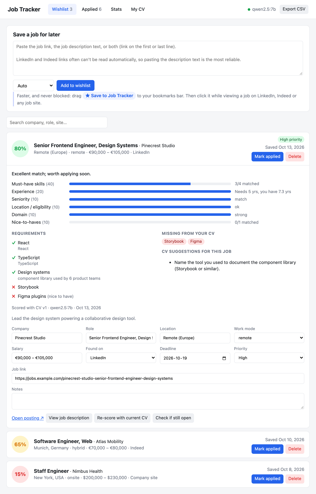
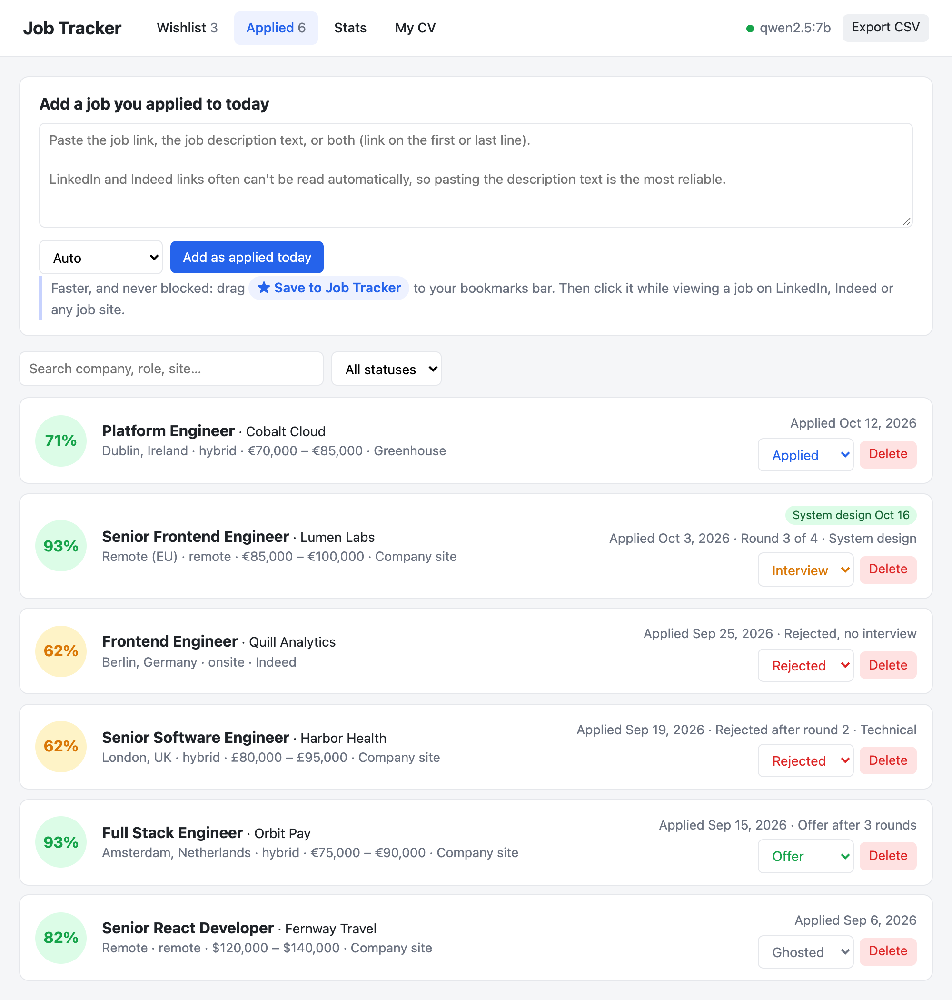
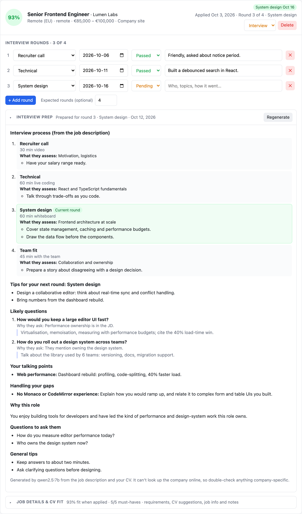
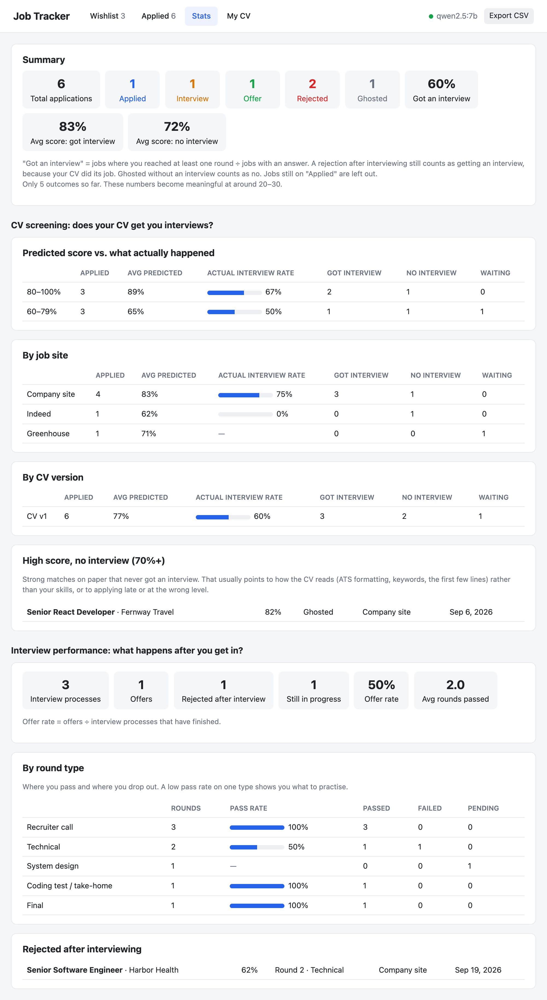
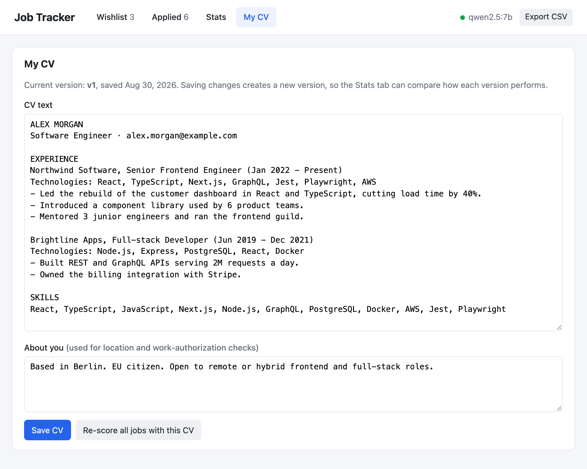
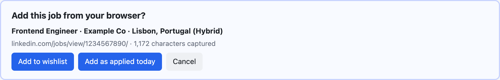

# Job Tracker

A small local web app for tracking job applications across LinkedIn, Indeed and any other site, without connecting your email.

Paste a job link or description and it fills in the details for you, then estimates your chance of getting an interview by comparing the job with your CV. Over time the Stats tab shows whether rejections come from your CV (high scores that never get interviews) or from the interviews themselves.

Everything runs on your machine. The AI is a local model through [Ollama](https://ollama.com), and your CV and jobs are stored in a local file that never leaves your computer.

> The screenshots below use fictional demo data.

## Wishlist

Jobs you want to apply to. Paste a link, the description text, or both, and the app reads the posting, extracts the company, role, location, salary and requirements, and scores it against your CV.

Open a card to see why it got that score: each must-have requirement with the line from your CV that matches it, what's missing from your CV, and suggestions for tailoring it to this job. When you apply, click **Mark applied** and the job moves to the Applied list with today's date.



## Applied

Jobs you've applied to, with their status: Applied, Interview, Offer, Rejected or Ghosted. Each card shows the score your CV had when you applied, how far you got, and flags like an upcoming interview.



Open a card to track interview rounds and prepare for the next one:

- **Interview rounds:** add each round as it happens (recruiter call, technical, system design, and so on) and mark it passed, failed or pending. Every company runs a different number of rounds, so you can set the expected total when you know it. Failing a round marks the job as rejected.
- **Interview prep:** generated from the job description and your CV. If the posting describes its interview process, the stages come from there; otherwise you get the typical stages for that kind of role. It also gives likely questions with answer hints, stories from your CV to use, how to handle gaps, and questions to ask them.
- **Job details & CV fit:** the same breakdown as the Wishlist, plus your notes.



## Stats

Answers two separate questions:

- **CV screening: does your CV get you interviews?** Compares the predicted score with what actually happened, broken down by score range, job site and CV version. It also lists jobs that scored highly but never got an interview, which usually points to how the CV reads rather than your skills.
- **Interview performance: what happens after you get in?** Offer rate, and pass rates by round type, so you can see whether you tend to drop out at technical rounds, system design, or somewhere else.



## My CV

Paste your CV as plain text, plus a short note about your location and work authorisation, which is used for location checks. Every time you save a changed CV it becomes a new version, so the Stats tab can show whether a new version gets more interviews. **Re-score all jobs with this CV** updates every score.



## Save to Job Tracker bookmark

Job sites, especially LinkedIn, often block automated access. The bookmark avoids that by sending the job you're already looking at straight to the tracker.

1. Drag **★ Save to Job Tracker** (below the paste box) to your browser's bookmarks bar.
2. While viewing a job on any site, click the bookmark.
3. The tracker opens and asks whether to add it to the Wishlist or as applied today. It warns you if the job is already saved.

If a site captures the wrong text, select the job description before clicking the bookmark and it will use your selection.



## How the score works

The model doesn't pick a number. It rates each requirement as matched, partial or missing and points to the evidence in your CV, then the score is calculated in code from fixed weights:

| Part | Weight |
|---|---|
| Must-have skills | 40 |
| Experience (years) | 20 |
| Seniority | 10 |
| Location / eligibility | 10 |
| Domain | 10 |
| Nice-to-haves | 10 |

Years of experience are also calculated in code from the dates of your relevant roles. If the job isn't open to you because of location or work authorisation, the score is capped at 15%. This keeps scores consistent from one job to the next, which is what makes the Stats tab meaningful.

## Running it

You need [Node.js](https://nodejs.org) 20 or later and [Ollama](https://ollama.com).

```bash
ollama pull qwen2.5:7b
npm install
npm start
```

Then open http://localhost:3000.

The model needs about 5 GB of memory. On a 16 GB machine, analysing a job takes one to a few minutes and interview prep a few more; jobs wait in a queue, so you can keep adding them.

### Try it with demo data

```bash
node scripts/demo-data.js /tmp/jt-demo/db.json
DB_FILE=/tmp/jt-demo/db.json PORT=3001 npm start
```

This loads the fictional jobs and CV used in the screenshots, without touching your own data.

### Settings

| Environment variable | Default | Purpose |
|---|---|---|
| `PORT` | `3000` | Port for the web app |
| `DB_FILE` | `data/db.json` | Where jobs and CV versions are stored |
| `MODEL` | `qwen2.5:7b` | Ollama model to use |
| `OLLAMA_URL` | `http://localhost:11434` | Ollama server address |
| `RETRY_DELAYS_MS` | about 2, 5, 15, 30 minutes | Comma-separated waits before retrying a rate-limited job link |

## Your data

All data is in `data/db.json`, which is excluded from git. **Export CSV** in the top bar downloads every job as a spreadsheet.

## Project structure

| File | What it does |
|---|---|
| `server.js` | Express API, the AI job queue, retries for rate-limited links |
| `llm.js` | Prompts and JSON schemas for Ollama: reading jobs, CV fit, interview prep |
| `scoring.js` | Turns the model's per-requirement ratings into the score |
| `fetchjob.js` | Fetches job pages, including LinkedIn's public job pages |
| `db.js` | Loads and saves the JSON database |
| `public/` | The web app (plain HTML, CSS and JavaScript) |
| `scripts/demo-data.js` | Generates the fictional demo database |
